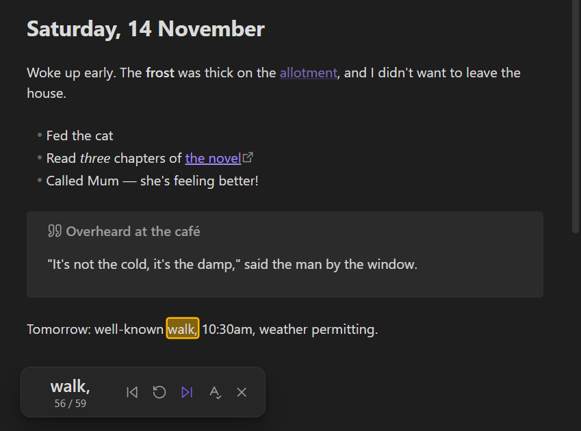

# Word by Word

Word by Word reads a note aloud **one word at a time** in [Obsidian](https://obsidian.md). It speaks the next word only when you press a key.

I built it for copying journal entries from Obsidian into a paper notebook. Looking up at the screen and back down to the page is slow, and it's easy to lose your place. With Word by Word you keep your eyes on the paper: press a key, hear a word, write it, press again.

It's useful any time you copy text by hand: journals, letters, lyrics, revision notes, or practising handwriting or a new script.



<!-- TODO: replace with a short demo GIF (docs/demo.gif) showing a few presses of "Next word". -->
> **Demo GIF coming soon.**

## Features

- **Strictly one word per press.** Nothing is spoken until you ask for the next word. Pressing again mid-word cuts the old word off at once, so presses never queue up or overlap.
- **Next, repeat, previous and spell.** Spelling reads the word letter by letter ("capital D, o, n, apostrophe, t") for tricky names and words.
- **Highlights the current word** in editing view (Source mode and Live Preview) and in reading view, and scrolls to keep it in sight.
- **A small control bar** shows the word, your position (e.g. `42 / 310`) and buttons for each action. You can use it with a mouse, a touchscreen, a foot pedal or a clicker.
- **Reads what you see, not the markdown.** Frontmatter, `#` heading marks, list markers, `**bold**` markers, link URLs, wikilink brackets, HTML comments and callout markers are all skipped. Links are read by their text, and wikilinks by their alias or note name.
- **Optional punctuation mode** says "comma", "full stop", "open quote", "new line", "new paragraph" and so on as separate steps, so you know exactly where punctuation goes on the page.
- **Selections.** Select some text first to read only that part.
- **Remembers where you stopped** in each note, so you can resume later.
- **Works offline** with your device's built-in voices. No accounts, no API keys, no network requests, no telemetry.

## Installation

### From Community plugins (once it's accepted)

1. Open **Settings → Community plugins** and turn off **Restricted mode** if it's on.
2. Select **Browse**, search for **Word by Word**, then select **Install** and **Enable**.

### With BRAT (beta versions)

1. Install and enable [BRAT](https://github.com/TfTHacker/obsidian42-brat) from Community plugins.
2. Run **BRAT: Add a beta plugin for testing** and enter `joshbroa/word-by-word`.
3. Enable **Word by Word** in **Settings → Community plugins**.

### Manually

1. Download `main.js`, `manifest.json` and `styles.css` from the [latest release](https://github.com/joshbroa/word-by-word/releases/latest).
2. Create the folder `<your vault>/.obsidian/plugins/word-by-word/` and put the three files in it.
3. Reload Obsidian, then enable **Word by Word** in **Settings → Community plugins**.

## How to use it

1. Open a note.
2. Run **Word by Word: Start from beginning** or **Word by Word: Start from cursor** from the command palette. If text is selected, only the selection is read.
3. Press your **Next word** hotkey for each word. Use **Repeat**, **Previous** or **Spell** whenever you need them.
4. Press **Stop and close** when you're done. Your place is saved; run **Resume where you left off** next time.

If nothing is being read, **Next word** starts reading from the cursor. That means a single pedal or clicker button is enough to begin.

### Commands

| Command | What it does |
| --- | --- |
| Start from beginning | Read the note (or the selection) from the start. |
| Start from cursor | Read from the word at the cursor. In reading view, from the first visible line. |
| Resume where you left off | Continue from the word you stopped on last time. Only shown when a position is saved. |
| Next word | Speak the next word. Starts reading from the cursor if nothing is being read. |
| Repeat current word | Say the current word again. |
| Previous word | Go back one word. |
| Spell current word | Spell the current word letter by letter. |
| Pause or resume auto-advance | Only shown when auto-advance is turned on. |
| Stop and close | Stop speaking, remove the highlight and close the control bar. |

### Recommended hotkeys

Word by Word sets **no default hotkeys**, so it never clashes with your existing shortcuts. Bind them in **Settings → Hotkeys** (search for "Word by Word"). The function keys are rarely used by Obsidian, so they're a good fit:

| Command | Suggested key |
| --- | --- |
| Next word | `F9` |
| Repeat current word | `F8` |
| Previous word | `F7` |
| Spell current word | `F10` |
| Start from cursor | `Ctrl`/`Cmd` + `F9` |
| Stop and close | `Ctrl`/`Cmd` + `F10` |

Obsidian warns you in the Hotkeys screen if a key is already in use. On many laptops you need to hold `Fn` to press function keys.

### Tip: use a foot pedal or clicker

Your hands are busy writing, so the best setup is often one you don't press with your hands:

- **USB foot pedals** (the cheap one-, two- and three-pedal "programmable" pedals sold for transcription and gaming) can usually be set to send any key. Set one pedal to `F9` (Next word) and another to `F8` (Repeat).
- **Bluetooth presentation clickers and page turners** usually send `Page Down`/`Page Up` or the arrow keys. You can bind those keys straight to **Next word** and **Previous word**. If you'd rather keep them for scrolling, remap the clicker to function keys with a tool such as AutoHotkey (Windows), Karabiner-Elements (macOS) or the clicker's own software.
- Set pedals to send **one key press per press**, not a repeating key while held, or you'll skip several words at once.

Hotkeys only work while the Obsidian window has focus, so click into Obsidian before you start.

## Settings

| Setting | Default | Description |
| --- | --- | --- |
| Voice | Automatic | Which installed voice to use. Automatic picks a British English voice if one is installed, otherwise your system's default voice. The speaker button plays a test phrase. |
| Speech rate | 0.9 | How fast each word is spoken (1 is normal speed). |
| Pitch | 1 | Voice pitch (1 is the voice's normal pitch). |
| Volume | 1 | Relative to your system volume. |
| Speak punctuation | Off | Say punctuation and line breaks as their own steps: "comma", "full stop", "question mark", "open quote", "close bracket", "new line", "new paragraph" and so on. |
| Skip code blocks | On | Leave out fenced code blocks. Turn off to read them word by word. |
| Auto-advance (seconds) | 0 (off) | Speak the next word automatically this many seconds after the last one finishes. Leave at 0 to advance only when you ask. |
| Highlight colour | Amber | Colour of the current-word highlight. |
| Show control bar | On | Show the floating bar with the current word, position and buttons. |
| Remember position in each note | On | Save the word you stopped on, per note, so you can resume. Positions follow renamed notes. |
| Forget saved positions | | Clear all saved positions. |

## What gets read

One step is one whitespace-separated word, with its punctuation still attached on screen (`Hello,`). Contractions (`didn't`), hyphenated words (`well-known`), numbers (`3.5`), dates (`14/11/2026`) and times (`10:30am`) each count as one word.

| In your note | What you hear |
| --- | --- |
| YAML frontmatter | Nothing |
| `## Heading` | "Heading" |
| `- item`, `1. item`, `- [ ] task` | "item", "task" |
| `**bold**`, `*italic*`, `~~struck~~`, `==highlight==` | The words, without the markers |
| `[link text](https://…)` | "link text" (never the URL) |
| `[[Note name]]`, `[[Folder/Note#Heading]]` | "Note name", "Note" |
| `[[Note name\|alias]]` | "alias" |
| `> [!note] Title` | "Title" and the callout text |
| `` `inline code` `` | "inline code" |
| Fenced code blocks | Skipped (configurable) |
| `<!-- comments -->`, `%% comments %%` | Nothing |
| `![[embeds]]`, `` | Nothing |
| Footnote markers, block IDs, HTML tags | Nothing |
| `#tags` | The tag without the `#` |

## Mobile

Word by Word is marked as working on mobile and uses only web APIs that the Obsidian mobile apps support. On mobile:

- The **control bar** is the easiest way to use it. The buttons get bigger touch targets. You can also add the commands to the mobile toolbar.
- Voices come from your phone or tablet's text-to-speech settings. On Android, pick a voice and install voice data in your system's text-to-speech settings. On iOS and iPadOS, enhanced voices can be downloaded in **Settings → Accessibility → Spoken Content → Voices**.
- Speech may stop when the screen locks or you switch apps.
- Bluetooth foot pedals and clickers that act as a keyboard work if you bind their keys in **Settings → Hotkeys**.

Mobile hasn't been tested on real devices yet. Reports are very welcome; see [Contributing](#contributing).

## Known limitations

- **Voices depend on your device.** The quality, the available accents and whether pitch is honoured all vary by operating system and voice. On Linux, speech needs `speech-dispatcher` and an installed voice (for example `espeak-ng`); without one, there are no voices.
- **Windows voices add trailing silence.** A short word takes about a second longer to "finish" than it sounds. This only affects auto-advance timing, which counts from the end of each word.
- **Reading view matches by text.** Reading view is rendered HTML, so the highlight is placed by finding the same occurrence of the word within its paragraph. Unusual content (transcluded notes, callouts without a title, plugin-rendered blocks) can occasionally put it on the wrong copy of a repeated word. The control bar always shows the right word. Editing view is exact.
- **In reading view, selections aren't supported.** **Start from cursor** begins at the first visible line instead. To read a selection, switch to editing view.
- **Embedded notes and images aren't read**, and neither is content generated by other plugins (such as Dataview queries) or inline maths.
- **Older systems may not show the reading-view highlight.** That highlight uses the CSS Custom Highlight API, which needs a recent Obsidian (desktop) or iOS 17.2+. Without it, the word still shows in the control bar.
- **Hotkeys only work while Obsidian has focus.**

## Privacy

Word by Word makes **no network requests** and collects **no data**. All speech uses the voices installed on your device through the Web Speech API. Some systems offer "online" voices (labelled as such in the voice picker); if you choose one, your operating system or browser engine may send the spoken words to its own speech service. The automatic choice prefers offline voices.

Saved positions (note path, character offset and the word) are stored in the plugin's `data.json` inside your vault.

## Contributing

Bug reports, feature ideas and pull requests are welcome. See [CONTRIBUTING.md](CONTRIBUTING.md) for how to set up the project, run the tests and load a development build into a test vault.

When reporting a bug, please include your operating system, Obsidian version, the voice you're using, and, if you can, a small piece of markdown that shows the problem.

## Licence

[MIT](LICENSE) © joshbroa

---

## Checklist: submitting to the community plugins directory

For maintainers. Check the current [submission docs](https://docs.obsidian.md/Plugins/Releasing/Submit+your+plugin) first, in case the process has changed.

- [ ] `npm run build`, `npm test` and `npm run lint` all pass.
- [ ] `manifest.json` is correct: `id` is `word-by-word` (no "obsidian"), `version` matches the release, `minAppVersion` and `isDesktopOnly` are accurate, and the `description` starts with a verb and ends with a full stop.
- [ ] `versions.json` maps the new version to `minAppVersion`.
- [ ] `README.md` and `LICENSE` are in the repository root.
- [ ] Create the release: run `npm version <x.y.z>` (no `v` prefix; it updates `manifest.json` and `versions.json`), then `git push --follow-tags`.
- [ ] Check the draft release that the GitHub Action created. It must have `main.js`, `manifest.json` and `styles.css` attached as separate files, and its tag must exactly match the version. Then **publish** it.
- [ ] Fork [obsidianmd/obsidian-releases](https://github.com/obsidianmd/obsidian-releases) and add this entry to the end of `community-plugins.json`:
  ```json
  {
  	"id": "word-by-word",
  	"name": "Word by Word",
  	"author": "joshbroa",
  	"description": "Read a note aloud one word at a time, advancing only when you press a key. Built for copying notes out by hand.",
  	"repo": "joshbroa/word-by-word"
  }
  ```
- [ ] Open a pull request titled "Add plugin: Word by Word", fill in the template and tick every item that applies.
- [ ] Fix anything the automated review bot reports, push a new release if needed, and reply on the PR.
- [ ] Wait for a human review, and answer any questions.
